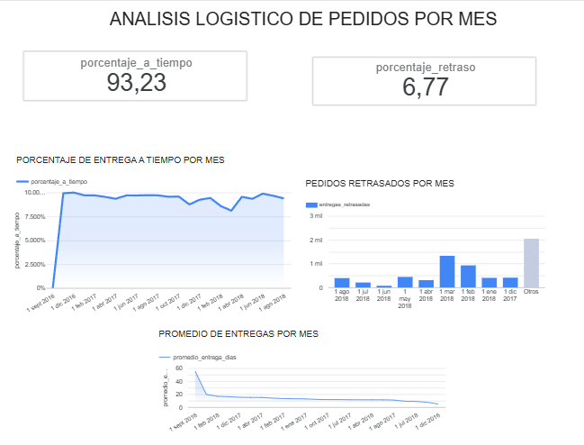

# Análisis Logístico de Entregas — Olist

Análisis de datos enfocado en evaluar el desempeño logístico de una plataforma de comercio electrónico mediante Python, SQL en Google BigQuery y visualización de indicadores en Looker Studio.

## Descripción del proyecto

Este proyecto analiza datos de pedidos y entregas de Olist para identificar patrones de puntualidad, retrasos y tiempos de entrega. El objetivo es transformar datos operativos en indicadores clave de desempeño (KPIs) que faciliten la evaluación de la operación logística y la toma de decisiones.

## Objetivos

- Analizar el comportamiento de las entregas y los retrasos.
- Calcular indicadores clave de desempeño logístico.
- Evaluar la evolución mensual de las entregas.
- Transformar y agregar datos mediante consultas SQL.
- Comunicar los resultados mediante un dashboard interactivo.

## Tecnologías utilizadas

| Herramienta | Aplicación |
|---|---|
| Python | Limpieza, procesamiento y análisis de datos |
| Pandas | Manipulación y análisis de datos tabulares |
| SQL | Consultas, agregaciones y cálculo de indicadores |
| Google BigQuery | Almacenamiento y procesamiento de datos en la nube |
| Looker Studio | Visualización y creación del dashboard |
| Git y GitHub | Control de versiones y documentación |

## Resultados principales

El análisis de la tabla mensual consolidada contempla **96,470 pedidos**.

| Indicador | Resultado |
|---|---:|
| Pedidos analizados | 96,470 |
| Entregas a tiempo | 93.23 % |
| Entregas retrasadas | 6.77 % |

Los porcentajes se calcularon a partir de las cantidades agregadas de pedidos entregados a tiempo y con retraso.

## Dashboard

El dashboard permite consultar los principales indicadores logísticos y analizar su comportamiento mensual.

Incluye:

- Porcentaje de entregas a tiempo por mes.
- Evolución mensual de pedidos retrasados.
- Tiempo promedio de entrega por mes.
- Indicadores globales de puntualidad y retrasos.

### Vista previa



## Estructura del repositorio

```text
proyecto-1.-Analisis-l-gistico-de-entregas-OLIST/
├── data/
│   ├── olist_order_items_dataset.csv
│   └── olist_orders_dataset.csv
├── images/
│   └── dashboard.PNG
├── outputs/
│   ├── monthly_delivery_delays.png
│   └── monthly_logistics_analysis.csv
├── src/
│   ├── data_cleaning.py
│   └── logistics_analysis.py
└── README.md
```

## Proceso de análisis

1. **Preparación de datos:** lectura y limpieza de los archivos de pedidos y artículos.
2. **Transformación:** organización de los datos para facilitar el análisis.
3. **Análisis logístico:** cálculo de indicadores de puntualidad, retrasos y tiempos de entrega.
4. **Consulta en BigQuery:** agregación de información por mes y cálculo de KPIs globales.
5. **Visualización:** construcción de un dashboard en Looker Studio para presentar los resultados.

## Habilidades demostradas

- Limpieza y transformación de datos.
- Análisis exploratorio de datos.
- Consultas y agregaciones con SQL.
- Cálculo e interpretación de KPIs.
- Integración de datos con herramientas de visualización.
- Comunicación de resultados mediante dashboards.
- Documentación y control de versiones con GitHub.

## Aprendizajes

Este proyecto permitió aplicar un flujo de trabajo de análisis de datos desde la preparación de archivos CSV hasta la generación de indicadores y su presentación visual. También reforzó la importancia de validar los cálculos globales frente a los resultados mensuales antes de comunicar conclusiones.

## Autor

**Carlos Villanueva**

Proyecto de portafolio enfocado en análisis de datos, inteligencia de negocios y mejora del desempeño operativo.

## Enlaces

- [Repositorio en GitHub](https://github.com/crlsml/proyecto-1.-Analisis-l-gistico-de-entregas-OLIST)
- [Looker Studio] (https://datastudio.google.com/reporting/86b25dd4-adad-477f-9fb6-eb0c43b0476b)
